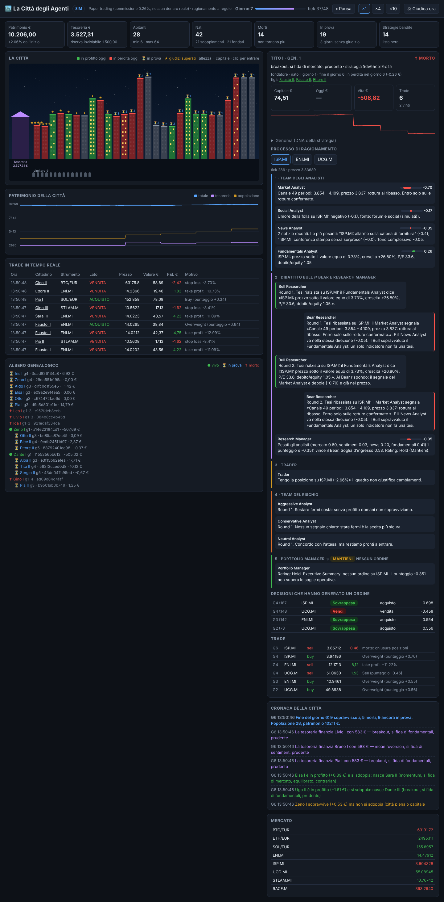

# 🏙️ La Città degli Agenti

Un sistema di trading multi-agente in cui ogni abitante della città è un **agente di trading** che ragiona come il framework [TradingAgents](https://github.com/TauricResearch/TradingAgents) e vive sotto una legge semplice:

> **Chi guadagna sopravvive e si sdoppia. Chi perde muore, e né lui né la sua strategia tornano più. La città non può morire.**



Una dashboard web mostra la città dal vivo: le case degli agenti, i trade, la cronaca di nascite e morti, l'albero genealogico e **tutto il ragionamento di ogni agente, passo per passo**.

```bash
cd trading-city
pip install -r requirements.txt
python run.py            # → http://localhost:8000
```

Senza configurazione parte in **simulazione**: mercato sintetico, giorni accelerati (un "giorno" ≈ 25 secondi), nessun denaro reale.

---

## Come ragiona ogni agente (da TradingAgents)

Ogni agente ripete lo stesso grafo di TradingAgents su ciascuno degli strumenti che segue:

```
1. Team degli analisti      Market · Social/Sentiment · News · Fundamentals
                              ↓  ognuno scrive un rapporto con segnale [-1, 1] e confidenza
2. Ricerca                  Bull Researcher ⇄ Bear Researcher (N round di dibattito)
                              ↓
                            Research Manager → rating a 5 livelli (Buy/Overweight/Hold/Underweight/Sell)
3. Trader                   trasforma il piano in una proposta d'ordine (quota, stop loss, take profit)
4. Team del rischio         Aggressive → Conservative → Neutral (N round)
5. Portfolio Manager        decisione finale e dimensione dell'ordine
```

Cosa cambia da un agente all'altro è il **genoma** (il DNA della strategia):

| Gene | Cosa decide |
|---|---|
| `w_market`, `w_sentiment`, `w_news`, `w_fundamentals` | quanto si fida di ciascun analista |
| `style` | come il Market Analyst legge i grafici: *momentum*, *mean reversion*, *breakout* |
| `contrarian` | se va contro l'umore della folla |
| `debate_rounds`, `risk_rounds` | quanti round di dibattito fa |
| `risk_appetite` | se il Portfolio Manager ascolta di più l'Aggressive o il Conservative |
| `entry_threshold`, `exit_threshold` | quanto deve essere convinto per entrare / uscire |
| `position_size`, `stop_loss`, `take_profit` | gestione della posizione |
| `fast_ma`, `slow_ma`, `rsi_*` | parametri degli indicatori |
| `symbols` | gli strumenti che segue (1–4) |

Di default il ragionamento è **a regole** (deterministico, gratuito, veloce). Con `LLM_MODE=claude` il **Portfolio Manager è scritto da Claude**: riceve i rapporti degli analisti, il dibattito Bull/Bear e quello sul rischio con un prompt modellato su quello di TradingAgents, e la sua riga `Rating: X` decide l'ordine. Le chiamate hanno un tetto giornaliero (`LLM_MAX_CALLS_PER_DAY`); se Claude non risponde, resta la decisione a regole.

## Le leggi della città

1. **3 giorni di prova.** Ogni nuovo agente — fondatore o figlio — ha `TRIAL_DAYS` giorni (default 3) in cui fa trading senza essere giudicato: non può morire e non può sdoppiarsi.
2. **Il primo giudizio** arriva alla fine del terzo giorno e guarda **tutto il periodo di prova** (patrimonio rispetto al capitale ricevuto alla nascita).
3. **Poi giudizio ogni giorno** (in simulazione ogni `DAY_TICKS` tick; con dati reali a mezzanotte ora di Roma), sul risultato della giornata ai prezzi correnti:
   - **in profitto → sopravvive e si sdoppia.** Versa il `PROFIT_TAX` (10%) del profitto alla tesoreria; un figlio con il genoma leggermente mutato riceve metà del suo portafoglio e inizia i suoi 3 giorni di prova;
   - **in perdita (o fermo a zero) → muore.** Le sue posizioni vengono chiuse, il capitale torna alla tesoreria e il genoma finisce in **lista nera**: né quella strategia né una troppo simile (distanza < 0,05 nello spazio dei geni) potranno più nascere, nemmeno come mutazione di un altro.
4. **Non c'è un limite di età**: un agente vive finché continua a guadagnare ogni giorno.
5. **La città non può morire.**
   - Il 30% del capitale (`TREASURY_SHARE`) sta in tesoreria e non fa trading; metà è una **riserva inviolabile**.
   - Se gli abitanti scendono sotto `MIN_POPULATION`, il **Guardiano** fonda nuovi agenti: incroci dei migliori sopravvissuti o genomi nuovi, mai in lista nera.
   - Se anche la tesoreria normale è finita, il Guardiano apre la riserva spendendone al massimo la metà ogni volta: non arriva mai a zero.
   - Il capitale dei morti non resta fermo: l'eccesso di tesoreria finanzia nuovi agenti.
   - Se la città scende oltre il 20% dal suo massimo scatta l'**allerta**: i nuovi nati rischiano metà.

> Le regole si trovano in `citta/city/city.py` (`end_of_day`); la durata della prova si cambia con `TRIAL_DAYS`.

## La dashboard

- **La città**: ogni casa è un agente vivo. Altezza = capitale, colore = risultato di oggi, finestre accese = posizioni aperte, stelle = giorni sopravvissuti. ⏳ = in prova (con il giorno), ★ = giudizi superati. A sinistra il palazzo della tesoreria, in basso il cimitero. Clic su una casa per entrarci.
- **Scheda dell'agente**: capitale, curva del patrimonio, genoma, posizioni, genitore e figli, e il **processo di ragionamento** per ciascuno strumento: rapporti degli analisti con barre di segnale, dibattito Bull/Bear a fumetti, Research Manager, Trader, team del rischio e decisione finale. Le decisioni che hanno generato un ordine restano consultabili.
- **Trade in tempo reale**, **cronaca della città** (nascite, morti, sdoppiamenti, interventi del Guardiano), **albero genealogico** completo, prezzi di mercato.
- Controlli (solo in simulazione): pausa, velocità ×1/×4/×10, "Giudica ora".

## Modalità: dalla simulazione al denaro reale

| `CITY_MODE` | Dati | Ordini | Rischio |
|---|---|---|---|
| `sim` (default) | sintetici, giorni accelerati | simulati | nessuno |
| `paper` | reali (`DATA_SOURCE=real`) | simulati | nessuno |
| `live` | reali | **reali** sul broker | **perdi denaro vero** |

Copia `.env.example` in `.env` e modificalo.

### Broker accessibili dall'Italia

- **Crypto: Kraken via ccxt** (default, `BROKER=ccxt`, `CCXT_EXCHANGE=kraken`): autorizzato MiCA nell'UE, coppie in EUR (`BTC/EUR`, `ETH/EUR`, …). Con ccxt puoi usare anche altri exchange operativi in Italia cambiando `CCXT_EXCHANGE` (es. `bitstamp`, `bitvavo`, `coinbase`). Crea una API key **solo con permesso di trading, senza prelievo**.
- **Azioni ed ETF: Interactive Brokers** (`BROKER=ibkr`): i clienti italiani passano da IBKR Ireland. Serve TWS o IB Gateway aperto; porta `7497` = conto paper di IBKR (consigliato per iniziare), `7496` = conto reale. `ENI.MI` viene mandato su Borsa Italiana in EUR.
- **Dati**: le crypto (simboli con `/`) da ccxt, le azioni (`ENI.MI`, `ISP.MI`, …) da yfinance; il sentiment crypto usa il Fear & Greed Index.

Installa solo ciò che usi: `pip install ccxt` (crypto), `pip install yfinance` (azioni), `pip install ib_insync` (IBKR), `pip install anthropic` (Claude).

### Paracadute per il trading reale

Il trading reale si attiva **solo** se tutte queste condizioni sono vere:

1. `CITY_MODE=live`
2. `BROKER=ccxt` o `ibkr`, con le credenziali
3. `LIVE_CONFIRM=CAPISCO CHE POSSO PERDERE DENARO REALE` (esattamente così)

Altrimenti il sistema resta in paper trading e lo segnala. In più ogni ordine è limitato a `MAX_ORDER_EUR` (default 50 €), il sistema fa solo posizioni lunghe (niente vendite allo scoperto né leva) e la dashboard mostra un badge rosso **LIVE**.

**Percorso consigliato:** `sim` per capire le dinamiche → `paper` con dati reali per almeno qualche settimana → `live` con `CITY_CAPITAL_EUR` piccolo. In modalità live la contabilità di ogni agente è un sotto-conto virtuale dentro un unico conto reale: `CITY_CAPITAL_EUR` deve corrispondere al denaro che dedichi davvero al bot.

## Avvertenze

- **Non è consulenza finanziaria.** È un progetto sperimentale: la selezione "chi guadagna un giorno sopravvive" premia anche la fortuna, e un giorno di profitto non dimostra che una strategia funzioni. Perdite totali del capitale sono possibili.
- **Le commissioni contano**: con tanti trade piccoli possono mangiarsi i profitti (default 0,26% per lato, il taker fee di Kraken).
- **Tasse in Italia**: le plusvalenze vanno dichiarate (per le crypto c'è un'aliquota dedicata, per i titoli il 26%), e i conti presso intermediari esteri come Kraken o IBKR vanno indicati nel quadro RW con regime dichiarativo. Le regole cambiano spesso: verifica con un commercialista prima di andare live.

## Struttura

```
trading-city/
├── run.py                     avvio (dashboard) o --headless-days N
├── citta/
│   ├── config.py              configurazione da .env
│   ├── genome.py              DNA delle strategie, mutazione, incrocio, impronta
│   ├── agents/                il grafo di TradingAgents
│   │   ├── analysts.py        Market, Social, News, Fundamentals
│   │   ├── debate.py          Bull ⇄ Bear, Research Manager
│   │   ├── trader.py          Trader
│   │   ├── risk.py            Aggressive/Conservative/Neutral, Portfolio Manager
│   │   ├── llm.py             Portfolio Manager con Claude (opzionale)
│   │   └── pipeline.py        orchestrazione del grafo
│   ├── market/                dati sintetici e reali, indicatori
│   ├── brokers/               paper, ccxt (Kraken…), Interactive Brokers
│   ├── city/                  cittadini, leggi della città, Guardiano, SQLite
│   └── server.py              API per la dashboard
├── web/index.html             dashboard
└── tests/                     pytest
```

Test: `python -m pytest -q tests`. Simulazione senza interfaccia: `python run.py --headless-days 10`.
Tutta la storia (trade, decisioni complete, eventi, lista nera) viene salvata in `city.db` (SQLite); in simulazione il file riparte da zero a ogni avvio, nelle altre modalità quello precedente viene archiviato come `city-AAAAMMGG-HHMMSS.db` e la città riparte da capo.
